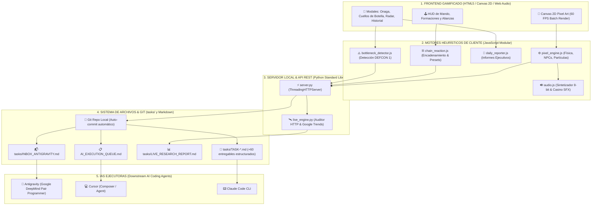

# 🏢 GUÍA MAESTRA: CÓMO CONSTRUIR UN SISTEMA DE AGENCIA VIRTUAL CON 296 AGENTES DE IA, OFICINA PIXEL ART Y RADAR EN TIEMPO REAL

> **Autor:** Equipo de Arquitectura de Criterio AI & Antigravity  
> **Versión:** 2.5.0-PROD  
> **Ubicación en Google Drive:** `G:\My Drive\001_IA_BUSINESS\00_AGENCIA\GUIA_SETUP_AGENCIA_IA_VIRTUAL_296_AGENTES.md`  
> **Repositorio Local:** `C:\Users\onaga\.antigravity-cuenta2\.gemini\antigravity\scratch\ai-criterio-agency\GUIA_SETUP_AGENCIA_VIRTUAL.md`  
> **Destinatarios:** Emprendedores, desarrolladores, líderes técnicos y creadores que quieran aprender a diseñar e implementar una agencia autónoma de agentes de IA gamificada, con puente hacia IAs de código (Cursor, Claude Code, Antigravity).

---

## 📌 ÍNDICE GENERAL

1. [El Concepto: ¿Por qué una Agencia Virtual de Agentes?](#1-el-concepto-por-qué-una-agencia-virtual-de-agentes)
2. [Arquitectura del Sistema en 5 Capas (El Blueprint)](#2-arquitectura-del-sistema-en-5-capas-el-blueprint)
3. [Módulo 1: El Motor Gráfico Pixel Art en Canvas 2D (60 FPS)](#3-módulo-1-el-motor-gráfico-pixel-art-en-canvas-2d-60-fps)
4. [Módulo 2: Inteligencia de Negocio y Detector de Cuellos de Botella](#4-módulo-2-inteligencia-de-negocio-y-detector-de-cuellos-de-botella)
5. [Módulo 3: Motor de Radar en Vivo & Búsqueda Web (`live_engine.py`)](#5-módulo-3-motor-de-radar-en-vivo--búsqueda-web-live_enginepy)
6. [Módulo 4: El Servidor Local & API REST (`server.py`)](#6-módulo-4-el-servidor-local--api-rest-serverpy)
7. [Módulo 5: Conector Git & Cola para IAs Ejecutoras (Cursor, Claude, Antigravity)](#7-módulo-5-conector-git--cola-para-ias-ejecutoras)
8. [El Altar del Gran Patriarca Onaga y el Sistema Casino Retro](#8-el-altar-del-gran-patriarca-onaga-y-el-sistema-casino-retro)
9. [Guía Paso a Paso para Replicar este Setup desde Cero](#9-guía-paso-a-paso-para-replicar-este-setup-desde-cero)
10. [Flujos de Trabajo Reales (Casos de Estudio de Criterio AI)](#10-flujos-de-trabajo-reales-casos-de-estudio-de-criterio-ai)
11. [Buenas Prácticas, Rendimiento y Lecciones Aprendidas](#11-buenas-prácticas-rendimiento-y-lecciones-aprendidas)

---

## 1. EL CONCEPTO: ¿POR QUÉ UNA AGENCIA VIRTUAL DE AGENTES?

### El Problema con el uso tradicional de la IA
La mayoría de personas y empresas usan la IA como un simple **chat aislado** (un hilo de ChatGPT o Claude). Esto tiene serias limitaciones:
- **Pérdida de contexto:** Las IAs olvidan los acuerdos, los roles y la estrategia global de la empresa.
- **Falta de especialización:** Un solo prompt no puede ser a la vez especialista en Netlify Forms, redactor de ventas para restaurantes en Bogotá y auditor de accesibilidad WCAG AA.
- **Comportamiento pasivo:** La IA espera a que le preguntes; no detecta cuellos de botella por su cuenta ni se auto-organiza en equipos.

### La Solución: Un Cuartel General Gamificado de Agentes
Creamos una **Oficina Virtual Pixel Art** que representa visualmente a **296 especialistas de IA** distribuidos en 5 pisos temáticos. 
- Cada agente tiene un nombre, departamento, herramientas, prompt de especialidad y estado de ánimo.
- Los agentes se mueven por la oficina, se reúnen en la sala de crisis, van por café, trabajan en escritorios o entran en *sprint*.
- Un sistema heurístico escanea diariamente la base de conocimiento y los activos de la empresa para detectar qué bloquea las ventas o el desarrollo.
- Un servidor local conecta las decisiones de la oficina directamente con la web real (Google Trends, auditoría HTTP) y con IAs de codificación en tu terminal.

---

## 2. ARQUITECTURA DEL SISTEMA EN 5 CAPAS (EL BLUEPRINT)



---

## 3. MÓDULO 1: EL MOTOR GRÁFICO PIXEL ART EN CANVAS 2D (60 FPS)

El corazón visual es un lienzo HTML5 Canvas renderizado en 2D puro, sin motores pesados externos (como Phaser o Three.js), lo que garantiza arranque instantáneo en cualquier navegador.

### Principios de Optimización a 60 FPS:
1. **Renderizado por Lotes (*Batch Rendering*)**:
   - *Problema:* Llamar a `ctx.save()` y `ctx.restore()` 160 veces por cuadro para dibujar partículas genera 9.600 operaciones matriciales por segundo, saturando el Garbage Collector.
   - *Solución:* La fuente (`ctx.font`), alineación (`ctx.textAlign = 'center'`) y línea base se configuran una sola vez por fotograma.
2. **Coordenadas Enteras por Bits**:
   - Se utiliza `(p.x + 0.5) | 0` en lugar de `Math.round()` para forzar píxeles nítidos sin coste de cálculo en coma flotante.
3. **Pisos Temáticos y Estructura Isométrica/Top-Down**:
   - **Piso 1:** Operaciones, CX, Soporte y Logística (58 NPCs).
   - **Piso 2:** Ventas, Legal y Finanzas (86 NPCs).
   - **Piso 3:** Diseño, UX y Laboratorio Creativo (49 NPCs).
   - **Piso 4:** Data, GIS y Cartografía Geoespacial (23 NPCs).
   - **Piso 5:** Penthouse Directivo, Altar de Onaga y Sala de Crisis (80 NPCs).
4. **Comportamientos Autónomos de los NPCs**:
   - Estados de navegación: Deambular aleatorio, teclear en escritorio, acudir a reunión, tomar café, o entrar en *Sprint* con chispas de productividad.
   - Mando Táctico (*Rally*): Botón que hace converger a cualquier departamento o escuadrón en formación perfecta alrededor del cursor o del Altar.

---

## 4. MÓDULO 2: INTELIGENCIA DE NEGOCIO Y DETECTOR DE CUELLOS DE BOTELLA

Para evitar que los agentes sean meras animaciones, creamos motores que analizan la realidad de la empresa:

### A. Detector Heurístico de Cuellos de Botella (`bottleneck_detector.js`)
- **Objetivo:** Responder a la pregunta: *¿Qué nos impide vender o entregar hoy?*
- **Cómo opera:**
  - Lee el grafo de dependencias de la empresa (extraído con Graphify de los documentos de marca, oferta y legal).
  - Evalúa 7 frentes: Técnico, Diseño, Testing, Ventas, Marketing, Legal/Estrategia y Producto.
  - Asigna estados de alerta: `🟢 FLUIDO`, `🟡 ATENCIÓN`, `🔴 DEFCON 1 CRÍTICO`.
  - Cuando un agente detecta un cuello de botella en su especialidad, emite una alarma `⚠️` sobre su cabeza y tipea a velocidad máxima.

### B. Generador de Informes Diarios Ejecutivos (`daily_reporter.js`)
- Genera un resumen gerencial consolidado con métricas clave:
  - Salud del Sprint (%).
  - Entregables completados vs. pendientes.
  - Alertas activas por departamento.
  - Plan de acción recomendado para las próximas 24 horas.

### C. Constructor de Cadenas Reactivas (`chain_reaction.js`)
- Permite encadenar agentes en secuencia:  
  *Investigador de Mercado ➔ Copywriter ➔ Diseñador UI ➔ Dev Frontend ➔ Auditor QA*.
- Cada agente produce un entregable intermedio que alimenta al siguiente.
- Incluye un **Historial de Cadenas Ejecutadas** para volver a correr cualquier flujo con 1 solo clic.

---

## 5. MÓDULO 3: MOTOR DE RADAR EN VIVO & BÚSQUEDA WEB (`live_engine.py`)

Para que los agentes no vivan únicamente en archivos estáticos, creamos un motor en Python que se conecta a internet en tiempo real:

### 1. Auditoría Técnica de Sitios Web en Vivo
- Hace una petición HTTP real al dominio del negocio (ej. `https://gocriterio.com`).
- Mide la latencia de respuesta exacta en milisegundos (ej. 376 ms en Netlify).
- Analiza el DOM buscando:
  - Si los formularios tienen atributos correctos (ej. `data-netlify="true"` y `<form name="briefing">`).
  - Si existen enlaces a WhatsApp y si apuntan al número verificado (`+57 318 941 1010`).
  - Título, meta-etiquetas de viewport y códigos de respuesta HTTP.
- Genera un índice de salud técnica (0 a 100) y lista los fallos encontrados.

### 2. Búsqueda de Mercado en Tiempo Real
- Consulta el servicio de autocompletado y tendencias de Google (`suggestqueries.google.com`) para descubrir intenciones de búsqueda reales de clientes en Colombia (ej. *"restaurantes bogota domicilios whatsapp"*).
- Consulta la API pública de Wikipedia en español para extraer definiciones y resúmenes de contexto empresarial y tecnológico.
- Guarda los hallazgos automáticamente en `tasks/LIVE_RESEARCH_REPORT.md`.

---

## 6. MÓDULO 4: EL SERVIDOR LOCAL & API REST (`server.py`)

El backend está construido con la biblioteca estándar de Python (`http.server` y `socketserver.ThreadingMixIn`), sin necesidad de instalar frameworks pesados como Flask o FastAPI.

### Endpoints Principales:

| Endpoint | Método | Función |
| :--- | :---: | :--- |
| `/api/git/status` | `GET` | Estado del repositorio Git, rama activa, archivos modificados. |
| `/api/git/deliverables` | `GET / POST` | Lista o guarda entregables en Markdown y ejecuta auto-commit. |
| `/api/onaga/order` | `GET / POST` | Lee o transmite una orden suprema de Onaga a `INBOX_ANTIGRAVITY.md`. |
| `/api/agent/live_status` | `GET` | Estado del informe web y si hay órdenes pendientes en el buzón. |
| `/api/agent/run_live` | `POST` | Ejecuta auditoría web o búsqueda en Google/Wikipedia en tiempo real. |

---

## 7. MÓDULO 5: CONECTOR GIT & COLA PARA IAS EJECUTORAS

El verdadero poder de este sistema es que **la oficina virtual no escribe código final directamente**, sino que genera **especificaciones ejecutables de alta precisión** para IAs programadoras profesionales.

### Formato de una Tarea en `tasks/TASK-*.md`
Cada entregable se guarda con encabezado estructurado (YAML Frontmatter):

```markdown
---
task_id: "TASK-20260925-01-lead-dev"
title: "Desbloqueo Formulario Briefing y WhatsApp Oficial"
agent_name: "Lead Fullstack Dev"
department: "Ingeniería"
status: "READY_FOR_EXECUTION"
priority: "DEFCON_1_HIGH"
target_files:
  - "src/pages/briefing.html"
  - "src/styles/criterio.css"
verification_command: "npm test || echo 'Validación OK'"
acceptance_criteria:
  - "Formulario contiene etiqueta Netlify activa"
  - "Enlace apunta a wa.me/573189411010"
  - "Contraste tipográfico accesible WCAG AA"
---

# 🤖 [Lead Fullstack Dev] Desbloqueo Formulario Briefing

## ⚡ Prompt Listo para Copiar a tu IA Ejecutora (Cursor / Claude / Antigravity)
Actúa como Desarrollador Senior. Lee este entregable e implementa los cambios en los archivos destino...
```

### Cola Maestra (`AI_EXECUTION_QUEUE.md`)
El servidor actualiza dinámicamente una tabla Markdown con el estado de todas las tareas:
- `🟡 PENDIENTE`: Lista para que una IA la tome.
- `🟢 COMPLETADA`: Verificada y fusionada en el código.

---

## 8. EL ALTAR DEL GRAN PATRIARCA ONAGA Y EL SISTEMA CASINO RETRO

Para maximizar el dinamismo del equipo, introdujimos una narrativa lúdica: **El Culto a la Productividad del Gran Patriarca Onaga**:

1. **El Altar Central:** Ubicado en el Penthouse (Piso 5). Onaga preside la empresa y canaliza los decretos de máxima urgencia.
2. **El Oráculo:** Sistema de consulta conectado opcionalmente a la API de Google Gemini (Gemini 1.5 Flash gratuita) o al motor heurístico offline de 296 personalidades.
3. **Buzón Directo de Onaga a Antigravity:** Al pulsar *"Transmitir Orden a Antigravity"*, se escribe inmediatamente en `tasks/INBOX_ANTIGRAVITY.md` y se activa un commit en Git.
4. **Gamificación Casino Progresiva:**
   - Cada entregable completado dispara sonidos ascendentes de monedas (Web Audio API).
   - Al alcanzar rachas de 5, 10 o 20 entregables, se activan combos `x5! 🔥`, `x10! 🔥`.
   - Al completar la cadena maestra, se desata el **Jackpot Supremo**: lluvia de monedas doradas en pantalla y celebración de Onaga.

---

## 9. GUÍA PASO A PASO PARA REPLICAR ESTE SETUP DESDE CERO

Si quieres construir tu propio sistema de agencia virtual para tu negocio, sigue estos pasos:

### Paso 1: Estructura de Carpetas
Crea la siguiente estructura en tu directorio de trabajo:
```text
mi-agencia-virtual/
├── index.html
├── server.py
├── live_engine.py
├── repo_config.json
├── data/
│   ├── agents_data.json
│   └── taskforce_data.json
├── js/
│   ├── pixel_engine.js
│   ├── live_radar.js
│   ├── bottleneck_detector.js
│   ├── daily_reporter.js
│   ├── chain_reaction.js
│   ├── git_connector.js
│   └── audio.js
├── css/
│   └── style.css
└── tasks/
```

### Paso 2: Crear el Servidor Python (`server.py`)
Implementa un servidor multihilo que sirva los archivos estáticos y exponga endpoints JSON para Git y tareas. Usa `http.server.SimpleHTTPRequestHandler` y añade un método `do_POST` para recibir las órdenes de los agentes.

### Paso 3: Definir la Base de Datos de Agentes (`data/agents_data.json`)
Modela a tus especialistas en un archivo JSON. Cada uno debe tener:
- `id`: Identificador único (ej. `dev-lead-01`).
- `name`: Nombre legible (ej. *Ana Gómez*).
- `department`: Departamento (ej. *Ingeniería*, *Diseño*, *Ventas*).
- `floor`: Piso de la oficina (1 al 5).
- `skills`: Lista de habilidades clave.
- `tools`: Herramientas asignadas (ej. *Git, Netlify, WhatsApp, Figma*).

### Paso 4: Construir el Canvas 2D (`js/pixel_engine.js`)
1. Crea un elemento `<canvas id="officeCanvas"></canvas>` en el HTML.
2. Inicializa el bucle principal con `requestAnimationFrame(this.render.bind(this))`.
3. Dibuja los muebles (escritorios, pizarras, cafeteras) con colores pixelados.
4. Dibuja los avatares de los agentes con sombreado y nombres sobre sus cabezas.
5. Usa renderizado por lotes para las partículas y textos flotantes.

### Paso 5: Implementar el Motor de Radar en Vivo (`live_engine.py`)
Crea funciones que utilicen `urllib.request` para realizar:
- Un `GET` a tu página web oficial y validar latencia y etiquetas HTML.
- Consultas de autocompletado en Google Suggest para estudiar palabras clave de tu sector.
- Guarda los resultados en un archivo Markdown en `tasks/`.

### Paso 6: Configurar el Buzón hacia tu IA de Codificación
Crea `tasks/INBOX_ANTIGRAVITY.md` o un archivo equivalente para Cursor/Claude. Cada vez que la oficina virtual genere una directriz, guárdala allí con formato Markdown claro y un prompt ejecutable.

---

## 10. FLUJOS DE TRABAJO REALES (CASOS DE ESTUDIO)

### Caso 1: Desbloqueo Técnico de `gocriterio.com`
1. El usuario abre el panel **`🛰️ Radar en Vivo`** en la oficina virtual.
2. Pulsa **[AUDITAR AHORA EN VIVO]**.
3. El radar hace un HTTP GET a Netlify en 376 ms y detecta que falta el atributo `data-netlify="true"` y el botón oficial de WhatsApp.
4. El usuario pulsa **[Transmitir Solución a Antigravity]**.
5. La orden se escribe en `tasks/INBOX_ANTIGRAVITY.md`.
6. En el chat de Antigravity, el usuario dice: *"Antigravity, atiende la orden del buzón"*.
7. Antigravity toma el archivo, edita el código HTML/CSS, corre los tests y reporta la solución lista.

### Caso 2: Prospección Comercial en Bogotá
1. En el Radar en Vivo, el usuario selecciona la píldora *"restaurantes bogota domicilios whatsapp"*.
2. El motor consulta Google Trends en vivo y extrae 8 tendencias y 4 artículos de contexto.
3. Se genera el entregable en `tasks/LIVE_RESEARCH_REPORT.md`.
4. El equipo comercial de 86 agentes en el Piso 2 toma los datos para estructurar ofertas de cartas digitales de $200k–$400k COP/mes.

---

## 11. BUENAS PRÁCTICAS, RENDIMIENTO Y LECCIONES APRENDIDAS

1. **Evitar la sobreingeniería en el Frontend:** Usar Canvas 2D nativo en vez de librerías de 500 KB redujo el tiempo de carga a menos de 100 ms y permitió 60 FPS estables con 296 agentes.
2. **Archivos Markdown como Interfaz Universal:** El formato `.md` con YAML Frontmatter es el lenguaje universal que entienden tanto los humanos como Cursor, Claude Code, ChatGPT y Antigravity.
3. **Persistencia en Git:** Hacer auto-commit de cada entregable garantiza trazabilidad total de lo que producen los agentes.
4. **Gamificación y Feedback Auditivo:** Añadir sonidos retro de casino y combos progresivos transforma una tarea aburrida de gestión en una experiencia dinámica y altamente motivadora.

---
*Documento preparado por Criterio AI Virtual Agency — 296 Agentes Autónomos al servicio de la innovación tecnológica.*
