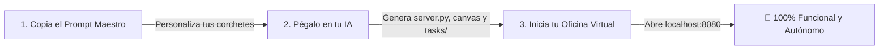

# ⚡ PROMPT MAESTRO & PLANTILLA UNIVERSAL: CREA TU PROPIA AGENCIA VIRTUAL DE AGENTES DE IA

> **Propósito:** Plantilla lista para copiar y pegar en cualquier IA (**Antigravity**, **Cursor**, **Claude Code**, **ChatGPT**) para que construya un **Cuartel General Virtual en Pixel Art** con agentes autónomos, detector de cuellos de botella, radar web en vivo y conector Git adaptado a **tu propia empresa y problema**.
> **Formatos Disponibles:** PDF, Word (.docx) y Markdown en Google Drive.

---

## 🎯 1. TABLA DE VARIABLES A PERSONALIZAR
Antes de copiar el prompt, rellena mentalmente o reemplaza los siguientes corchetes con los datos de **tu empresa**:

| Variable | Qué poner aquí | Ejemplo |
| :--- | :--- | :--- |
| `[NOMBRE_DE_TU_EMPRESA]` | Nombre comercial de tu negocio o agencia | *Nexora Dental / FoodHero / SaaSMetrics* |
| `[DESCRIPCION_DE_TU_NEGOCIO]` | Qué vendes, a quién y cómo generas valor | *Software de citas para clínicas odontológicas en México* |
| `[SITIO_WEB_OFICIAL]` | URL de tu web o landing page a auditar | *https://miempresa.com* |
| `[CANAL_DE_VENTAS]` | Tu enlace o número de contacto directo | *https://wa.me/5215512345678 o soporte@miempresa.com* |
| `[PROBLEMA_CRITICO_O_SPRINT]` | El gran obstáculo que te impide crecer hoy | *Nuestra landing no convierte leads y el formulario falla* |
| `[NUMERO_DE_AGENTES]` | Cantidad de especialistas que deseas simular | *50 agentes / 100 agentes / 200 agentes* |
| `[NOMBRE_DEL_LIDER]` | Nombre del avatar del líder o CEO | *Comandante Mateo / Gran Patriarca Onaga / CEO Alpha* |
| `[DEPARTAMENTOS_CLAVE]` | Las 4 a 7 áreas principales de tu empresa | *Ingeniería, Diseño UX, Ventas, Marketing, Legal, QA* |

---

## 📋 2. EL PROMPT MAESTRO (COPIA Y PEGA ESTO COMPLETO EN TU IA)

```text
Actúa como Arquitecto de Software Senior y Diseñador de Sistemas Agénticos.

Tu misión es construir desde cero un Cuartel General de Agencia Virtual Gamificado en Pixel Art (Canvas 2D HTML5 a 60 FPS) impulsado por un equipo de [NUMERO_DE_AGENTES] agentes de IA autónomos, diseñado específicamente para mi empresa:

================ DATOS DE MI EMPRESA ================
• Empresa: [NOMBRE_DE_TU_EMPRESA]
• Modelo de Negocio: [DESCRIPCION_DE_TU_NEGOCIO]
• Sitio Web Oficial: [SITIO_WEB_OFICIAL]
• Canal de Conversión Principal: [CANAL_DE_VENTAS]
• Misión / Sprint Crítico Actual: [PROBLEMA_CRITICO_O_SPRINT]
• Líder Supremo de la Oficina: [NOMBRE_DEL_LIDER]
• Departamentos Clave: [DEPARTAMENTOS_CLAVE]
======================================================

Quiero que generes una aplicación web local completa y funcional con la siguiente arquitectura en 5 módulos:

1. MOTOR GRÁFICO PIXEL ART EN CANVAS 2D (index.html + js/pixel_engine.js):
   - Una oficina isométrica o top-down dividida en pisos temáticos según mis departamentos clave.
   - Renderizado en Canvas 2D nativo a 60 FPS con Batch Rendering (configurar ctx.font y ctx.textAlign una sola vez por cuadro y usar enteros a nivel de bits para que nunca haya lag).
   - [NUMERO_DE_AGENTES] NPCs animados con comportamientos autónomos: trabajar en escritorios, reunirse en la pizarra, ir por café o entrar en "Modo Sprint" con chispas de productividad.
   - Un botón de mando táctico "Rally" para agrupar departamentos en formación alrededor del cursor o del líder [NOMBRE_DEL_LIDER].
   - Sistema de gamificación estilo casino retro (Web Audio API): cuando los agentes completan entregables, suenan monedas progresivas con combos x5, x10 y un Jackpot de lluvia de monedas al resolver el sprint.

2. DETECTOR HEURÍSTICO DE CUELLOS DE BOTELLA (js/bottleneck_detector.js):
   - Un motor que analiza las dependencias de [NOMBRE_DE_TU_EMPRESA] y alerta en tiempo real con estados: 🟢 FLUIDO, 🟡 ATENCIÓN, 🔴 DEFCON 1 CRÍTICO.
   - Debe evaluar el problema crítico: "[PROBLEMA_CRITICO_O_SPRINT]" y marcar con alarmas "⚠️" sobre la cabeza de los agentes del departamento responsable hasta que se resuelva.

3. MOTOR DE RADAR WEB EN TIEMPO REAL (live_engine.py + js/live_radar.js):
   - Un endpoint en Python que hace una auditoría HTTP en vivo a [SITIO_WEB_OFICIAL]: mide la latencia real en ms, detecta formularios de captura, valida si el enlace [CANAL_DE_VENTAS] está presente y asigna un puntaje de salud técnica de 0 a 100.
   - Búsqueda de mercado en vivo: consulta las tendencias de búsqueda de Google y la base de conocimiento de Wikipedia sobre mi sector y guarda los hallazgos en tasks/LIVE_RESEARCH_REPORT.md.

4. CADENAS REACTIVAS & INFORME EJECUTIVO (js/chain_reaction.js + js/daily_reporter.js):
   - Un constructor visual para encadenar agentes en secuencia (ej. Investigador ➔ Copywriter ➔ Diseñador ➔ Desarrollador ➔ QA).
   - Guardar un historial de cadenas ejecutadas para poder volver a correr cualquier flujo con 1 solo clic.
   - Un generador de Informes Diarios Ejecutivos con métricas de salud del sprint, tareas listas y plan para las próximas 24 horas.

5. SERVIDOR LOCAL & CONECTOR GIT PARA IAS EJECUTORAS (server.py + tasks/):
   - Servidor HTTP multihilo en Python estándar (sin frameworks pesados).
   - Generador de entregables en Markdown dentro de la carpeta tasks/ con YAML Frontmatter estructurado (task_id, target_files, acceptance_criteria, verification_command y un prompt listo para copiar).
   - Un archivo tasks/INBOX_ANTIGRAVITY.md donde el líder [NOMBRE_DEL_LIDER] deposita órdenes prioritarias con 1 clic.
   - Actualización dinámica de AI_EXECUTION_QUEUE.md con la tabla de tareas pendientes y completadas, junto con auto-commit en Git local.

Entrega todos los archivos de código fuente listos, configurados con los datos de [NOMBRE_DE_TU_EMPRESA], y las instrucciones para ejecutar el servidor con `python -u server.py`.
```

---

## 🚀 3. CÓMO PONERLO EN MARCHA EN 3 PASOS



### Paso 1: Rellena los datos de tu empresa
Sustituye los corchetes del prompt (ej. cambia `[NOMBRE_DE_TU_EMPRESA]` por el nombre real de tu negocio y `[SITIO_WEB_OFICIAL]` por tu URL).

### Paso 2: Pégalo en tu IA preferida
- **En Antigravity o Cursor:** Abre una carpeta vacía y pega el prompt en el chat. La IA creará los archivos de forma autónoma.
- **En Claude Code:** Pega el prompt directamente en tu terminal.
- **En ChatGPT (GPT-4o):** Pídele que genere el código paso a paso y guarda los archivos en tu máquina.

### Paso 3: Arranca tu Cuartel General
Abre tu terminal en la carpeta generada y ejecuta:
```bash
python -u server.py
```
Abre tu navegador en `http://localhost:8080/` ¡y tu ejército de agentes estará trabajando para ti!

---

## 🛠️ 4. CÓMO ORDENARLE A OTRA IA QUE EJECUTE LAS TAREAS

Cuando tu oficina virtual genere tareas en la carpeta `tasks/`, abre tu IA de código (**Cursor**, **Claude Code** o **Antigravity**) y dale esta directriz:

> *"Actúa como Desarrollador Senior para `[NOMBRE_DE_TU_EMPRESA]`. Lee el archivo `tasks/INBOX_ANTIGRAVITY.md` y `AI_EXECUTION_QUEUE.md`. Toma la siguiente tarea pendiente en `tasks/` e implementa la solución exacta en el código fuente respetando los criterios de aceptación y ejecutando las pruebas."*
